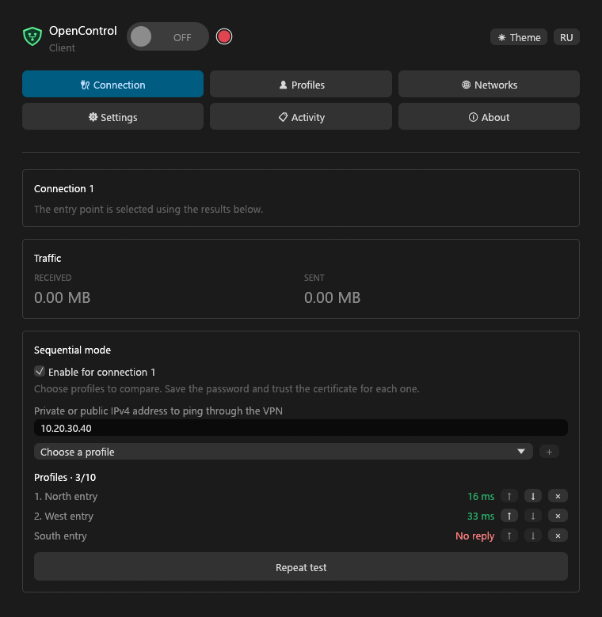
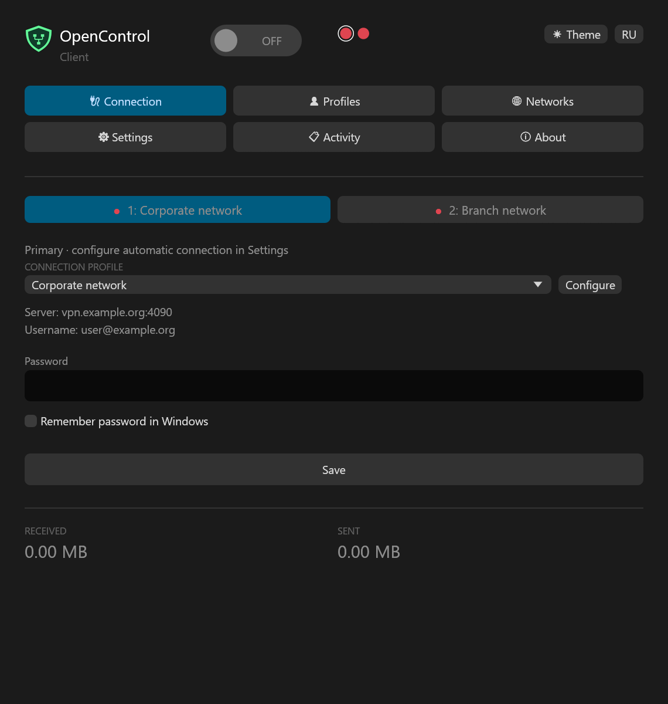
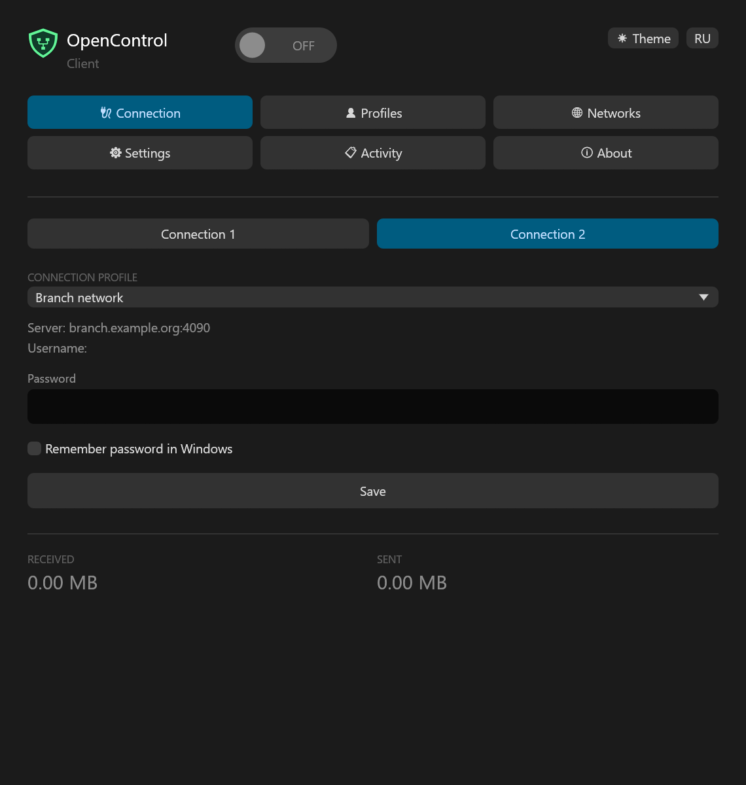
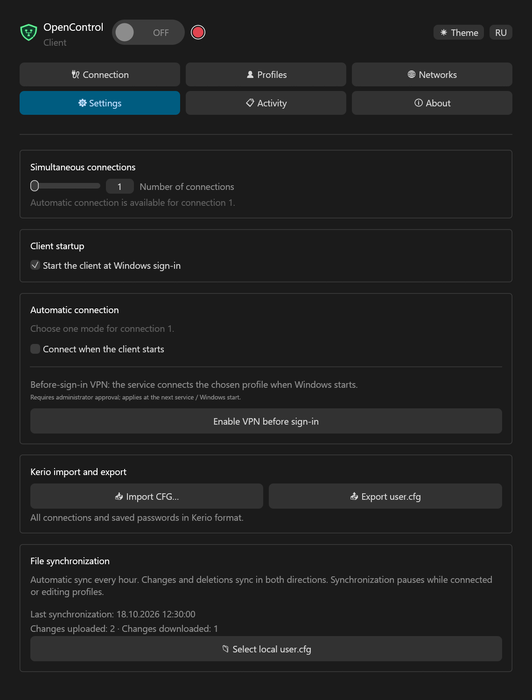
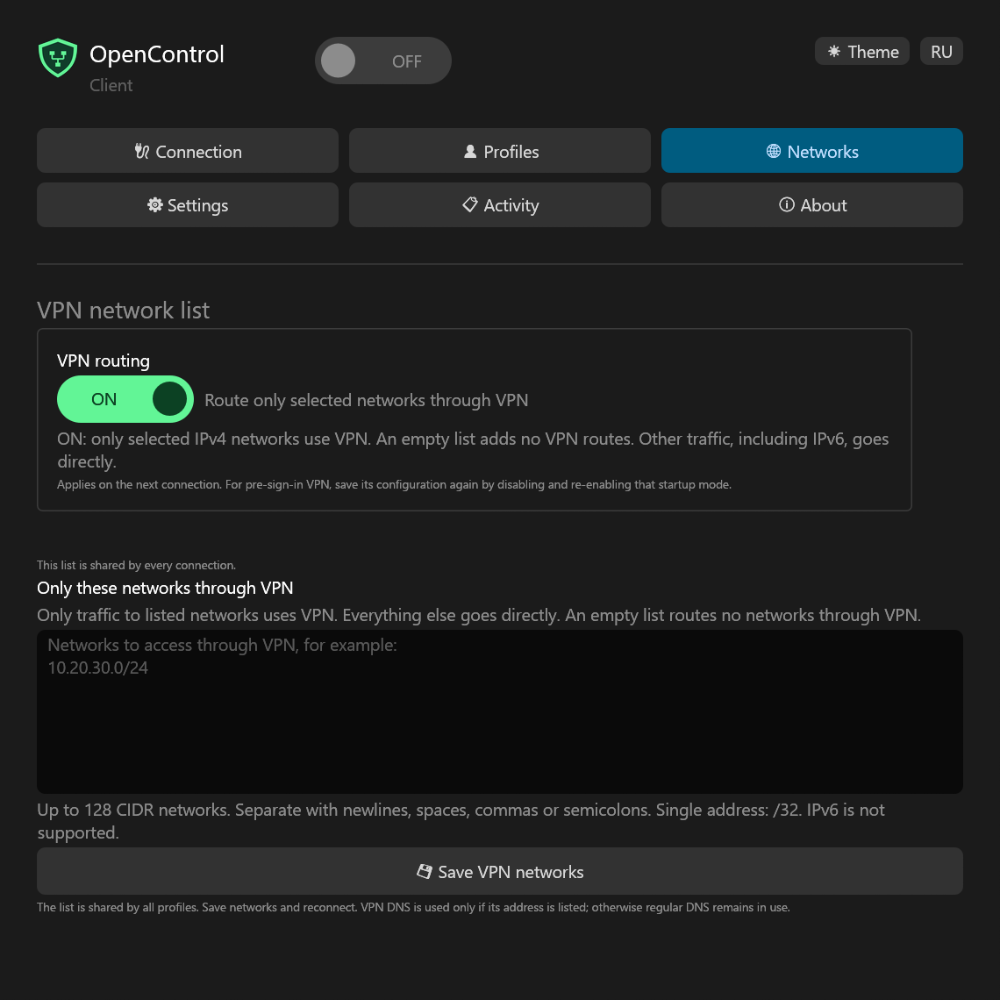
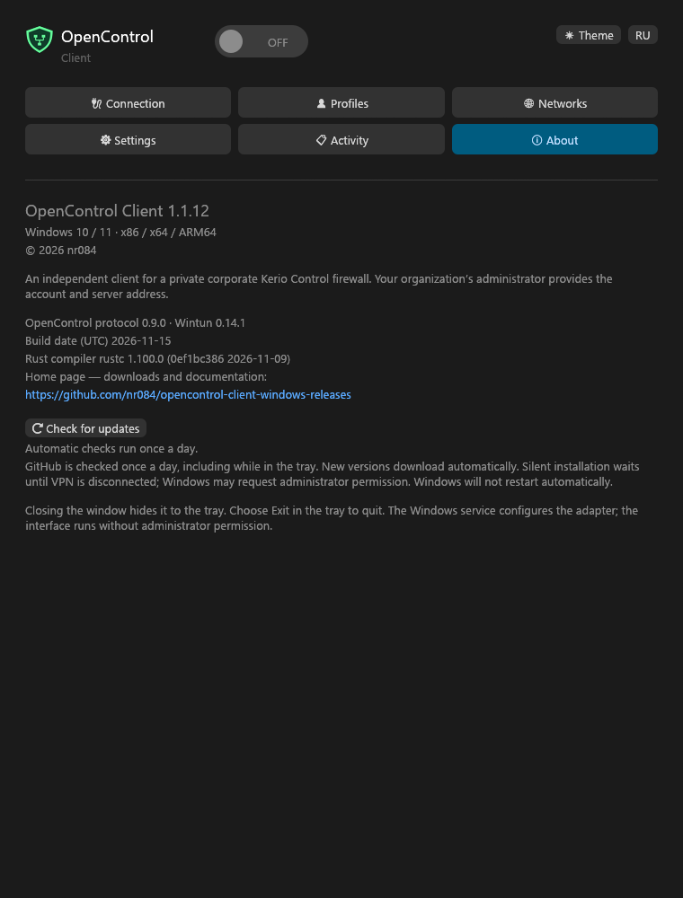
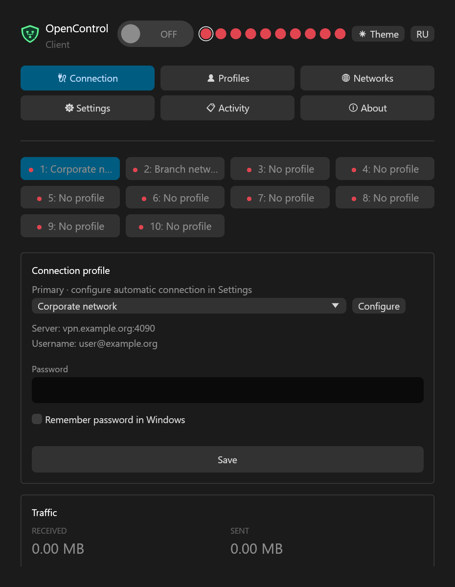
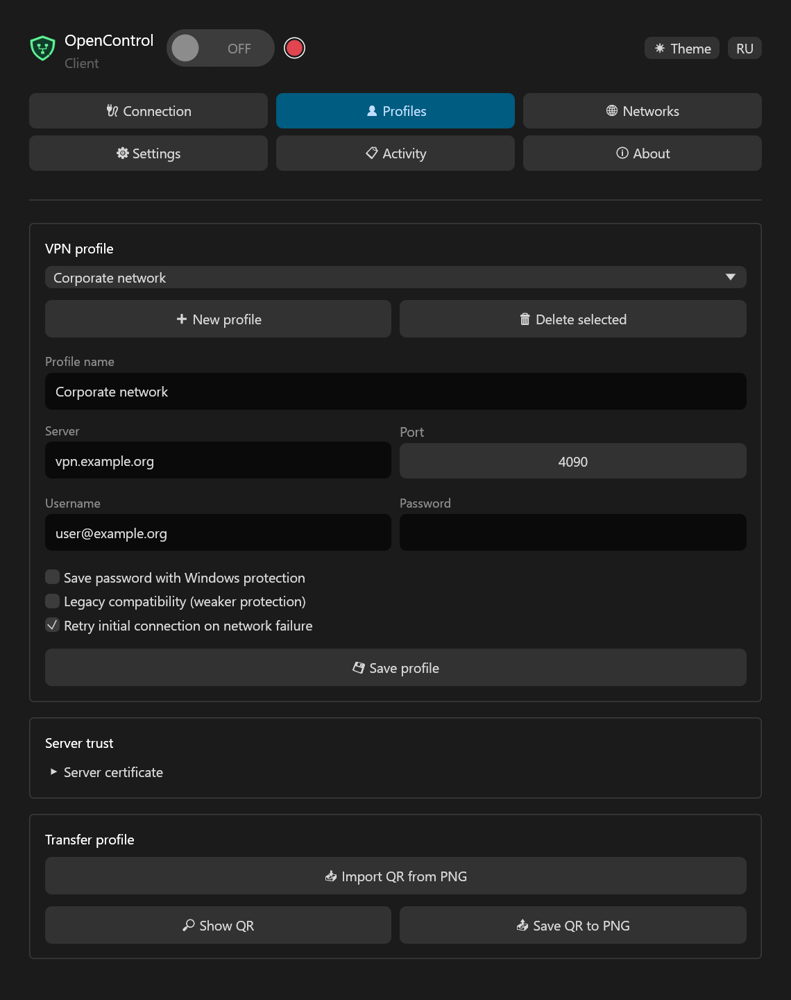
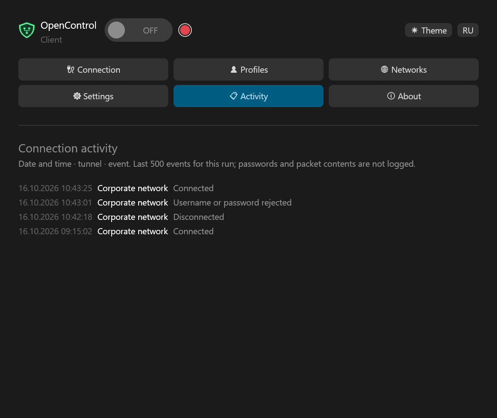

<h1 align="center">OpenControl Client</h1>

VPN for private Kerio Control networks · Windows 10 and 11

<a href="README.md">Русский</a> · <b>English</b>

<a href="https://github.com/nr084/opencontrol-client-windows-releases/releases/latest">Download 1.6.1</a> · <a href="RELEASE_NOTES.md">Changelog</a> · <a href="SHA256SUMS">SHA256</a>

You need your organization's Kerio Control address and credentials. OpenControl Client is an independent VPN client.

After shutdown or restart, the service restores the saved VPN before sign-in and retries if the network or adapter is still coming up.

## Install

| Windows | Installer |
|---|---|
| 64-bit Windows on Intel or AMD | [x64](https://github.com/nr084/opencontrol-client-windows-releases/releases/download/v1.6.1/OpenControl-client-1.6.1-windows-x64.msi) |
| 32-bit Windows 10 | [x86](https://github.com/nr084/opencontrol-client-windows-releases/releases/download/v1.6.1/OpenControl-client-1.6.1-windows-x86.msi) |
| Windows 11 on ARM, including a Windows VM on Mac | [arm64](https://github.com/nr084/opencontrol-client-windows-releases/releases/download/v1.6.1/OpenControl-client-1.6.1-windows-arm64.msi) |

Each MSI includes Russian and English. Russian is selected on first launch. Use **EN / RU** to switch. In **Profiles**, add a connection or import it from Kerio, then turn on the VPN. Verify the certificate fingerprint with your administrator when prompted.

## Up to ten VPNs at once

**Connection 1** can use an optional sequential mode below the traffic section. Add up to ten profiles and test a private or public IPv4 address through them. Responsive profiles are ranked by average latency and used as a failover queue. The mode is off by default.

1. In **Settings**, choose between 1 and 10 connections.
2. On the **Connection** tab, open a numbered subtab, select a profile, and click **Save**. Use the switch at the top to connect.
3. Use the numbered tray menus to change a profile, disconnect, or reconnect an individual tunnel.

The indicators beside the switch show every configured connection. Left-click to open its subtab, or right-click for slot actions. The tray badge displays the count when at least two tunnels are active.

With two or more slots configured, Connect all and Disconnect all appear above Exit in the tray. Each command sends one Windows notification covering all affected tunnels. You can add profiles and edit or delete idle profiles while other tunnels are running.

Two independent Kerio servers can run side by side when their corporate destinations can be routed unambiguously. You can also use the first tunnel for internet access and the second for a branch network. Only connection 1 can connect automatically after sign-in or before Windows sign-in. Start other connections manually.

Connection 1 can carry the default route and configure VPN DNS on Windows. Additional connections route traffic to their own networks. Reach them by IP or by names that your existing DNS configuration can resolve. Duplicate subnets, server addresses, or assigned VPN IPs can conflict. OpenControl rejects conflicting routes or tunnels when a destination is ambiguous. Plan distinct subnets for separate private networks.

## Features

| Section | Features |
|---|---|
| Profiles | Sorting, Windows-protected saved passwords, QR export, explicit compatibility mode for old servers |
| Settings | Kerio import with a file picker and duplicate handling, export, two-way `user.cfg` sync, startup options |
| Networks | One list for all connections. Exclude listed networks or tunnel only listed networks that the corresponding server serves |
| Tray | Red dot with no VPN, green with an active VPN, amber count with two or more tunnels. Profile and traffic tooltips, notifications, and double-click to show or hide the window |
| History | Time, connection number, profile, connects, disconnects and errors |
| About | Client and Rust versions, build date, a GitHub link, and manual update check |

Interface screenshots

## Checks and limitations

The Wintun driver is publisher-signed. The OpenControl EXE and MSI have no publisher signature. Verify [SHA256](SHA256SUMS). Uninstall from the Windows list of installed apps. For data and licensing details, see the [privacy policy](PRIVACY.en.md) and [third-party notices](THIRD-PARTY-NOTICES.txt).
