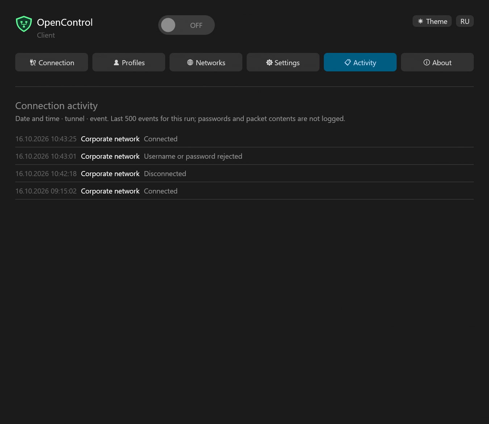
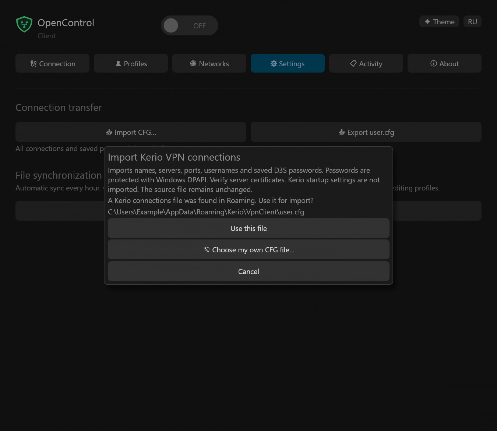
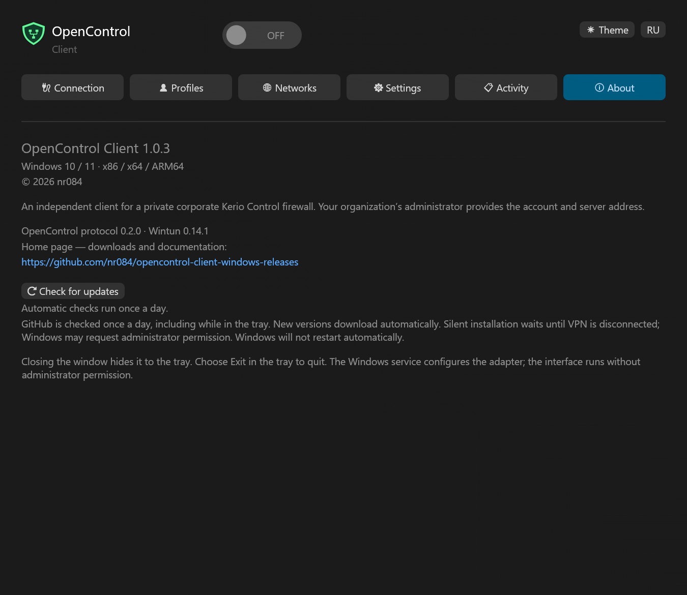

<h1 align="center">OpenControl Client</h1>

Your organization’s network · Windows 10 / 11

<a href="README.md">Русский</a> · <b>English</b>

<a href="https://github.com/nr084/opencontrol-client-windows-releases/releases/latest">Download 1.0.3</a> · <a href="RELEASE_NOTES.md">What’s new</a> · <a href="SHA256SUMS">SHA256</a>

OpenControl connects your PC to a private corporate network through Kerio Control. Your organization supplies the server address and account. This independent client is not an official Kerio/GFI product or a provider of VPN access.

## Install and connect

Each MSI includes Russian and English. **Russian is the default on first launch**, regardless of the Windows language. Click **EN / RU** to switch; your choice is saved.

| Computer | Download |
|---|---|
| Intel / AMD 64-bit PC | [x64](https://github.com/nr084/opencontrol-client-windows-releases/releases/download/v1.0.3/OpenControl-client-1.0.3-windows-x64.msi) |
| Windows 10, 32-bit | [x86](https://github.com/nr084/opencontrol-client-windows-releases/releases/download/v1.0.3/OpenControl-client-1.0.3-windows-x86.msi) |
| Windows on ARM, including a Windows 11 VM on Mac | [ARM64](https://github.com/nr084/opencontrol-client-windows-releases/releases/download/v1.0.3/OpenControl-client-1.0.3-windows-arm64.msi) |

1. Install the app. Desktop and Start menu shortcuts are created by default.
2. Add a connection in **Profiles**, or import your CFG in **Settings**.
3. Select the profile and turn the switch **ON**. No separate permission checkbox is needed.
4. When prompted, verify the server certificate fingerprint with your administrator before trusting it.

Once connected, the window hides in the tray and a notification identifies the tunnel. A failure reason, such as an incorrect password, appears beside the switch. Hover to read longer messages.

## Window and tray controls

| Feature | How it works |
|---|---|
| Close the window | The X hides the app in the tray, even while disconnected |
| Connection indicator | Green dot with a white rim: connected. Red cross: disconnected |
| Reopen | Click the tray icon or select Open OpenControl Client |
| Reconnect | Right-click the tray → Reconnect; the old session finishes before the next starts |
| Disconnect or exit | Disconnect ends VPN; Exit also closes the app |
| Traffic totals | Hover over the tray for session Upload / Download; totals also appear in the window |
| Windows startup | Starts in the tray without connecting VPN automatically; enable or disable it in Settings |
| Appearance | Light/dark theme, Windows Segoe UI, DPI scaling and multi-size icons; no 3D accelerator required |
| Activity | Connection events, without passwords or packet contents |

Windows may put the icon in its overflow area. Notification visibility depends on Windows settings. After an established connection drops, the client attempts to restore it and retains session traffic totals.

## Connection history

The activity log keeps the time, tunnel name, connections, disconnections and errors across profile changes: up to 500 events in memory until exit, newest first, using Windows local time. The client reports its actual version to the server: **1.0.3 · build 4**, visible on the next connection.

With multiple profiles, use **Switch profile** in the tray menu: choosing a profile disconnects the old tunnel and connects the selected one automatically. A password or certificate prompt appears only when needed.

## Profiles and QR

Add, edit and delete connections while VPN is disconnected. Profiles sort by name. Deletion has a separate confirmation button; a profile can be set as default.

Use a password for one session or save it with Windows protection for the current user. Text fields support copy/paste. Password fields accept paste but do not copy or cut hidden passwords.

Move one profile using **Show QR**, **Save QR to PNG**, or **Import QR from PNG**. The format is compatible with OpenControl for Android.

New or changed certificates require confirmation; expired certificates require a separate decision. Trust is remembered for that profile’s specific certificate.

## Kerio import and file synchronization

**Import CFG…** looks for `user.cfg` only in `%APPDATA%\Kerio\VpnClient` (Roaming). If found, it displays the path and offers **use this file**, **choose your own CFG**, or **cancel**. If missing, the file picker opens directly. Profiles stay unchanged until you choose and confirm the import. This offer works both on first launch and during manual import. Names, servers, ports, usernames and supported saved D3S passwords are imported. Unsupported passwords need manual entry; certificate trust is not imported.

Duplicates require **Keep existing**, **Replace from file**, or **Keep both**. Normal import leaves the original file unchanged. Up to 100 profiles are supported.

Export follows the Kerio layout: UTF-8 without BOM, LF, two-space indentation and an `application` section. Synchronization preserves existing application options.

**Export user.cfg** saves all profiles and saved passwords in Kerio format; session-only passwords are excluded. The file contains portable passwords, so treat it as access data. Synthetic re-import is tested; acceptance by the external Kerio client still needs checking.

**Select local user.cfg** links the profile list to a file:

- Edits and deletions synchronize both ways.
- Checks run hourly or with **Sync now**.
- Checks pause while connecting, connected, or editing profiles.
- Conflicting edits ask you to choose a version.
- A missing or malformed file never clears the profile list.
- **Unlink file** preserves both the file and local profiles.

Settings shows the last sync time, uploaded/downloaded change counts or an error reason. Current profile/password edits are saved first. Temporary errors retry hourly; conflicts require a decision.

Network paths are unsupported. The file is not uploaded to the cloud.

## Networks outside VPN

In **Networks**, enter destinations that should use your regular connection, such as `192.168.1.0/24` or `10.0.0.5/32`. These are shared IPv4 exclusions for all profiles, up to 128 entries, applied on the next connection. Per-app routing and IPv6 exclusions are not provided.

## VPN before Windows sign-in

1. In **Profiles**, choose the default profile, save its password and trust the server certificate.
2. In **Settings**, choose **Enable VPN before sign-in** and approve UAC.
3. On the next Windows start, the service connects the saved profile before anyone signs in, retrying temporary network failures.

After sign-in the client takes control of the running tunnel. Disconnecting or switching profiles finishes the previous tunnel first. **Disable VPN before sign-in** disables future service-start connections; use the ordinary switch to disconnect the current session. Apply the setting again after changing the password, certificate, default profile or network exclusions.

This is a computer-wide setting. Its protected connection copy uses Windows DPAPI and SYSTEM/Administrators-only access. Configuration requires administrator approval. Unknown or changed certificates are never silently accepted. Uninstall removes this copy; upgrades preserve it.

**Start the client at Windows sign-in** controls only the user application, independently of the pre-sign-in VPN.

## Updates, uninstall and checks

**About** contains the home page link and **Check for updates** button. GitHub is checked automatically once a day, including while the window is hidden in the tray. A newer version adds a yellow exclamation badge alongside the VPN status indicator and shows a notification with its version.

The client downloads the MSI for its architecture and checks SHA256 against the checksum file and GitHub metadata. Installation waits until VPN is disconnected and editing is finished, then runs without the setup wizard; Windows may request UAC. No restart is forced. After a successful update, the main window opens. Normal Windows sign-in startup remains in the tray. Equal or older versions are never installed automatically. Retry the manual check after an error or cancellation.

For manual MSI installation, first choose **Exit** from the tray.

Uninstall through **Windows Settings → Apps → OpenControl Client → Uninstall**. The program, service, shortcuts and startup entry are removed; profiles and external CFG files remain. Installation and removal require administrator rights, ordinary operation does not. The service starts with Windows and serves one VPN session at a time.

The Wintun driver is officially signed. Project EXE/MSI files are not yet publisher-signed. Check [SHA256SUMS](SHA256SUMS).

85 automated tests, three architecture builds and MSI content checks passed. Retry after authentication failure was tested with a synthetic Windows pipe; native tray updates were also checked. Full operation on the target ARM VM and a real firewall remains outside these tests. See [VALIDATION.md](VALIDATION.md).

All screenshots contain fictional profiles. This repository publishes installers and documentation; client sources are private. The [protocol library](https://github.com/nr084/opencontrol-protocol) is a separate public project.

[Changelog](RELEASE_NOTES.md) · [Privacy](PRIVACY.en.md) · [Component licenses](THIRD-PARTY-NOTICES.txt)

About

© 2026 nr084
