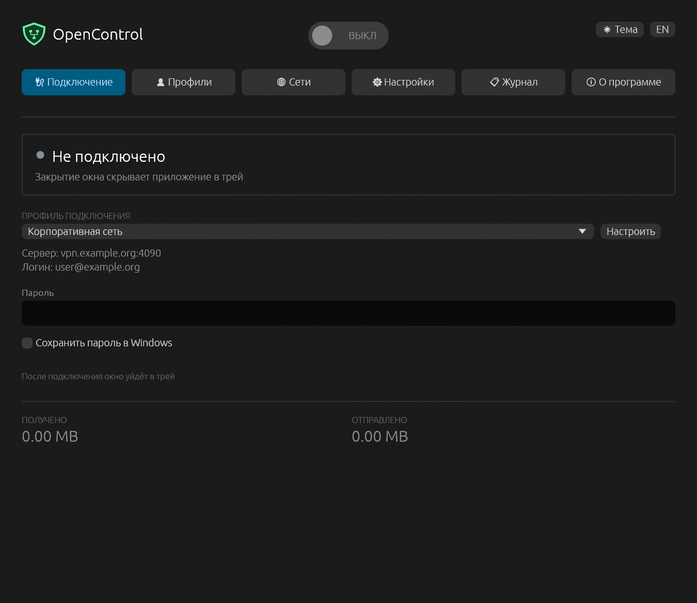
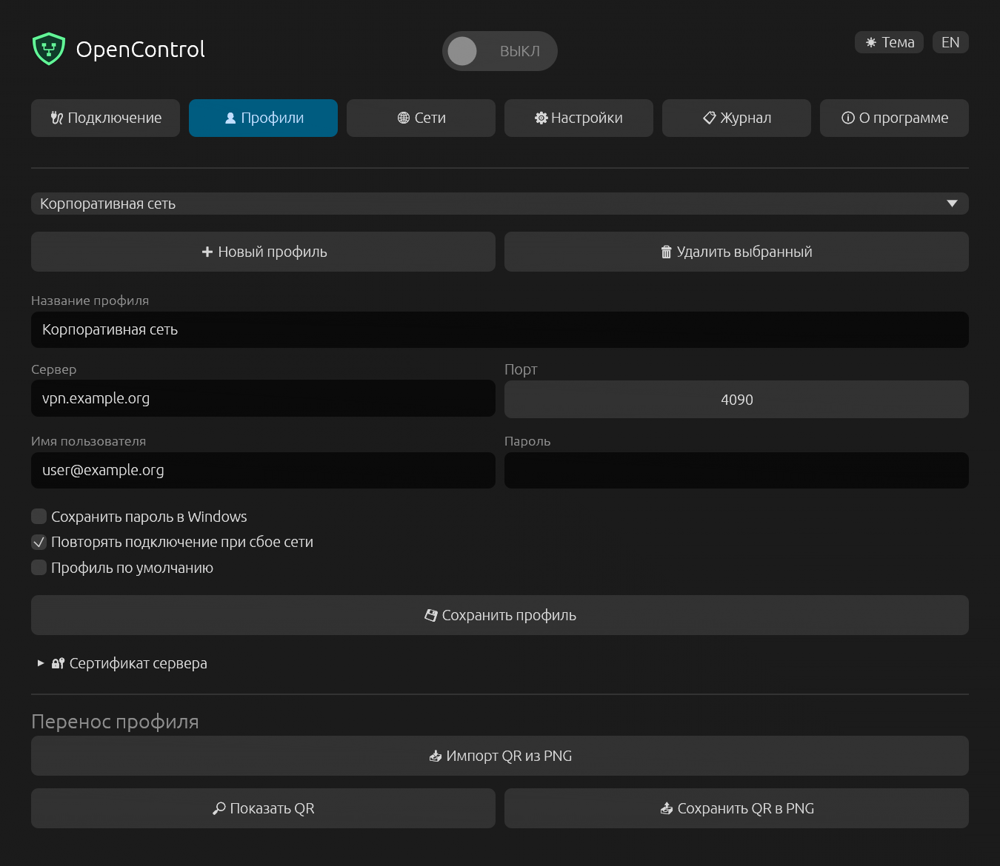
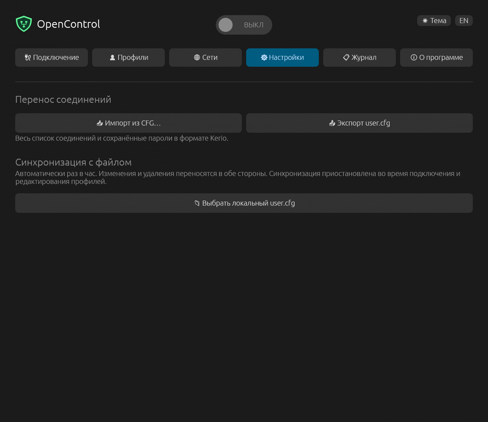
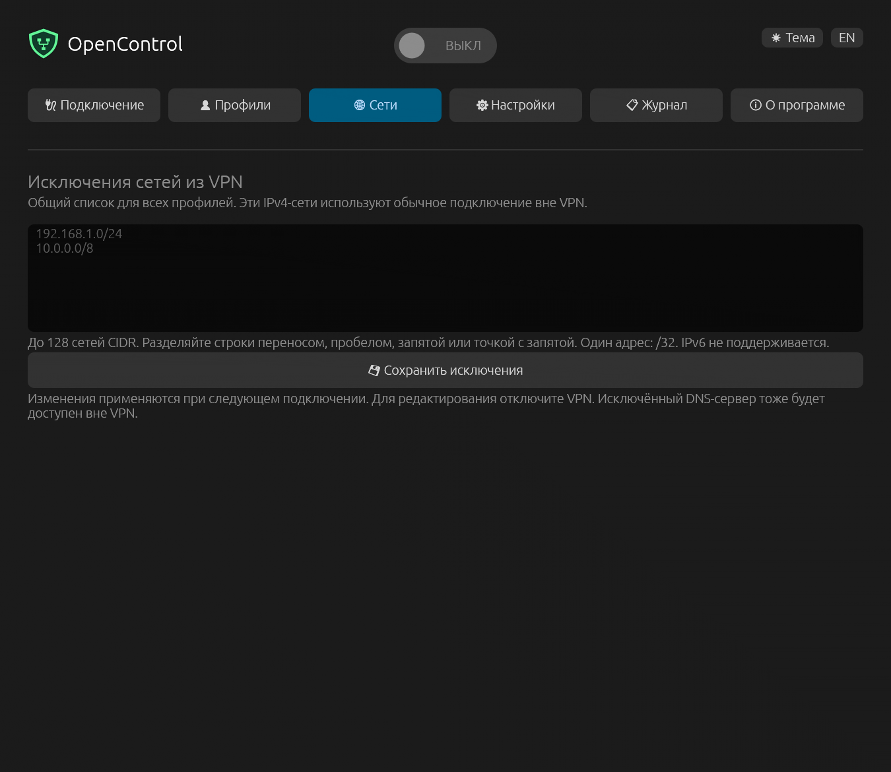

<h1 align="center">OpenControl для Windows</h1>

Ваша корпоративная сеть · Windows 10 / 11

<b>Русский</b> · <a href="README.en.md">English</a>

Независимый VPN-клиент для частного корпоративного firewall Kerio Control на базе OpenControl Protocol Library. Адрес сервера и учётную запись предоставляет ваша организация. Проект не выдаёт VPN-доступ.

## Установка и удаление

[Скачать MSI](https://github.com/nr084/opencontrol-client-windows-releases/releases).

| Система | Пакет |
|---|---|
| Windows 10/11 Intel/AMD 64-bit | x64 |
| Windows 10 32-bit | x86 |
| Windows 10/11 ARM64 | arm64 |

Один MSI на архитектуру, приложение содержит русский и английский языки. Установщик на русском. Ярлыки рабочего стола и меню «Пуск» устанавливаются по умолчанию.

Версия 1.0.0 устанавливает службу **OpenControl VPN** (`OpenControlVpn`) от LocalSystem с автоматическим запуском. Служба управляет адаптером, маршрутами и DNS. Интерфейс запускается с обычными правами: пользователь может управлять подключением без UAC. Права администратора требуются для установки, обновления и удаления. Одновременно служба обслуживает одну VPN-сессию; управлять ею может только клиент, создавший соединение с локальным каналом службы. При аварийном закрытии интерфейса сессия завершается.

Перед обновлением или удалением выберите **«Выйти»** в меню трея. Удаление: **Параметры Windows → Приложения → Установленные приложения → OpenControl → Удалить**, либо стандартный `msiexec /x` с исходным MSI. Установщик останавливает и удаляет службу, файлы программы и оба ярлыка. Пользовательские профили и внешние файлы синхронизации сохраняются. Общий драйвер Wintun не удаляется из системы, если он используется другими приложениями.

Wintun 0.14.1 — официальный подписанный драйвер WireGuard LLC. EXE/MSI проекта пока не подписаны сертификатом издателя; это отдельный вопрос от подписи драйвера. Сверяйте SHA256SUMS.

## Подключение и интерфейс

1. Во вкладке **«Профили»** нажмите **«Новый профиль»**, задайте название, сервер, порт (обычно 4090), логин и пароль. Сохраните профиль.
2. Выберите профиль во вкладке **«Подключение»**. Профили отсортированы по названию без учёта регистра.
3. Включите VPN центральным переключателем между названием OpenControl и кнопкой темы. При первом соединении проверьте отпечаток сертификата с администратором. Изменившийся сертификат требует новой проверки.
4. После успешного подключения окно скрывается в трей; уведомление называет подключённый туннель. Показ зависит от настроек уведомлений Windows.

Крестик окна скрывает его в трей без отключения VPN. Значок трея присутствует всё время работы: зелёная точка с белой обводкой при подключении, красный крестик без подключения. Windows может поместить значок в область скрытых значков. В меню правой кнопки: открыть окно, переподключиться, отключить и **«Выйти»**. Только «Выйти» завершает приложение и очищает сетевые настройки. Переподключение сначала завершает старую сессию.

Зелёный щит занимает почти весь значок, фон прозрачный. Интерфейс рисуется на CPU через Windows GDI: OpenGL, DirectX и 3D-ускоритель не требуются. Масштабирование учитывает DPI Windows. Светлая и тёмная темы переключают фон и текст. Индикатор ожидания не вращается в состоянии «Подключено».

Ctrl+C / Ctrl+X / Ctrl+V работают в текстовых полях. Пароль можно вставить, но скрытый пароль не копируется и не вырезается в буфер. Сохранённые пароли защищены Windows DPAPI для пользователя и профиля.

Добавление и удаление профилей доступны после отключения VPN. **«Удалить выбранный»** — кнопка с подтверждением. После удаления последнего профиля остаётся пустой редактор.

## Настройки: Kerio и синхронизация

При первом запуске клиент предлагает просмотреть найденный `%APPDATA%\Kerio\VpnClient\user.cfg`. Импорт происходит только после подтверждения. Для выбора другого файла откройте **«Настройки → Импорт Kerio»**. Переносятся названия, серверы, порты, логины и сохранённые пароли D3S; доверие сертификатам и автозапуск Kerio не переносятся. Для дублей нужно выбрать: оставить существующие, заменить данными файла или сохранить оба варианта. Лимит 100 профилей. Неподдерживаемый пароль потребуется ввести вручную. Обычный импорт не изменяет исходный файл.

**«Экспорт user.cfg»** сохраняет весь список в XML-формате Kerio вместе с сохранёнными паролями. Пароль, введённый только для текущей сессии, в CFG не включается. Совместимость формата проверена синтетическим обратным импортом; приём файла сторонним клиентом Kerio требует отдельной проверки.

**«Выбрать локальный user.cfg»** включает двустороннюю синхронизацию, включая удаления. При первом связывании списки объединяются; разные варианты одной записи требуют выбора. Затем изменения определяются относительно последней синхронизации. При одновременном изменении одной записи клиент предлагает оставить её версию или взять версию файла. Остальные изменения объединяются. Проверка выполняется раз в час, когда VPN отключён и вкладка редактирования профилей закрыта. Недоступный, повреждённый файл или неподдерживаемые пароли приостанавливают синхронизацию, не очищая список. **«Отключить связь»** оставляет файл и профили.

Используется локальный диск; сетевые пути не поддерживаются. Общие параметры Kerio вне списка соединений сохраняются. CFG содержит переносимые пароли в обратимом формате Kerio: храните файл с ограниченным доступом. Клиент не передаёт его в облако.

## QR и исключения сетей

Во вкладке «Профили» доступны импорт QR из PNG, **«Показать QR»** и **«Сохранить QR в PNG»**. Формат совместим с Android-клиентом OpenControl.

Во вкладке **«Сети»** задаются общие исключения IPv4 для всех профилей, до 128 CIDR: например `192.168.1.0/24` или `10.0.0.5/32`. Исключённые сети и DNS-серверы используют обычное подключение вне VPN. Изменения применяются со следующего подключения. IPv6-исключений и выбора приложений нет.

## Статус выпуска

1.0.0 — выпуск с проверками, перечисленными ниже. Автоматические проверки описаны в [VALIDATION.md](VALIDATION.md). Работа в конкретной Windows 11 ARM VM на Mac и реальное корпоративное подключение требуют проверки на целевой системе. Сборка не заменяет эту проверку.

[Конфиденциальность](PRIVACY.md) · [English privacy policy](PRIVACY.en.md)

Открытый репозиторий содержит только бинарники и пользовательские документы. Исходники клиента — в приватном репозитории; [protocol-библиотека](https://github.com/nr084/opencontrol-protocol) — отдельный публичный проект. Клиент не является официальным продуктом Kerio/GFI.

Профили, настройки и исключения сетей

## Поведение версии 1.0

Интерфейс открывается после нажатия «Готово» при интерактивной установке. При входе в Windows он запускается в трей, без автоматического подключения VPN. Автозапуск можно отключить средствами Windows. Тихая установка не открывает окно; удаление убирает запись автозапуска.

Переключатель показывает ВКЛ/ВЫКЛ, вкладки занимают равные колонки. Значок с прозрачным фоном, плавным контуром и несколькими размерами. При подключении в трее зелёная точка с белой обводкой. Подсказка показывает суммарно отправленный и полученный трафик сессии, включая автоматические переподключения. Новая сессия, начатая вручную, сбрасывает счётчики.

В диалоге импорта можно выбрать любой CFG, в том числе при первом запуске. Для дублей по серверу, порту и логину требуется выбор: оставить существующие, заменить из файла или сохранить оба варианта. При замене сохраняются идентификатор профиля и доверие сертификату, пароль перепривязывается к этому профилю. Если сохранить оба варианта, для подключения синхронизации может потребоваться устранить дубли. Экспорт предлагает имя user.cfg; синхронизация связанного файла выполняется раз в час в свободном состоянии либо вручную кнопкой «Синхронизировать».

Новый или изменившийся сертификат требует подтверждения. Просроченный — отдельного согласия, привязанного к его отпечатку. Доверие и согласие запоминаются для профиля; другой сертификат требует нового решения.
