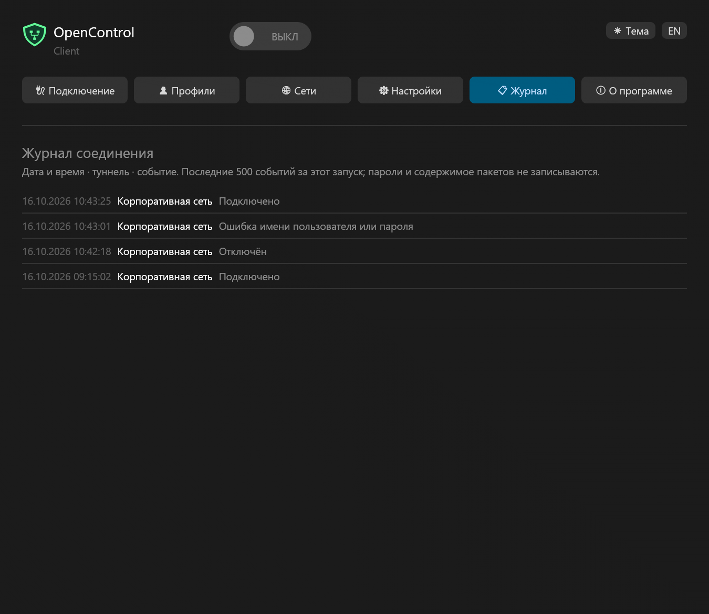
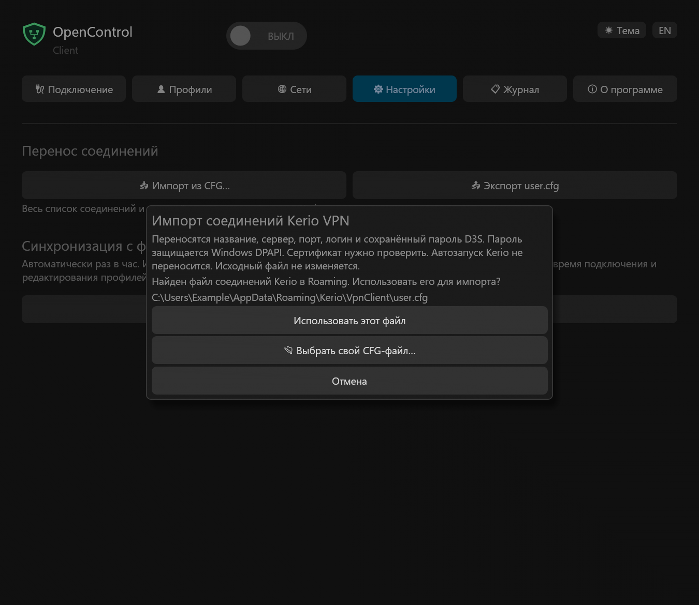
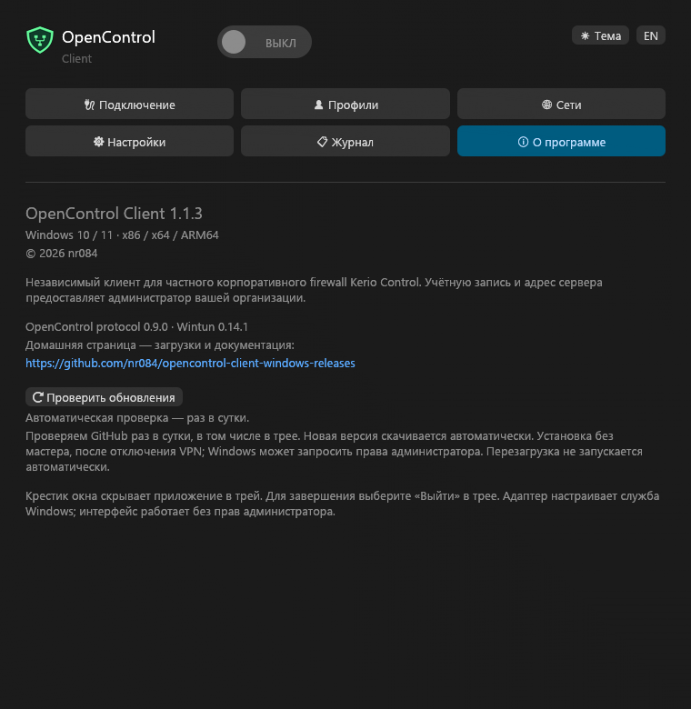

<h1 align="center">OpenControl Client</h1>

Доступ к сети вашей организации · Windows 10 / 11

<b>Русский</b> · <a href="README.en.md">English</a>

<a href="https://github.com/nr084/opencontrol-client-windows-releases/releases/latest">Скачать 1.1.3</a> · <a href="RELEASE_NOTES.md">Что нового</a> · <a href="SHA256SUMS">SHA256</a>

OpenControl подключает компьютер к частной корпоративной сети через Kerio Control. Адрес сервера, логин и пароль выдаёт ваша организация. Это независимый клиент, не официальный продукт Kerio/GFI и не сервис продажи VPN-доступа.

## Установить и подключиться

Выберите MSI для своего компьютера. В каждом пакете есть **русский и английский**, при первом запуске выбран **русский**. Кнопка **EN / RU** меняет язык; ваш выбор сохраняется.

| Компьютер | Скачать |
|---|---|
| Обычный ПК Intel / AMD, 64 бита | [x64](https://github.com/nr084/opencontrol-client-windows-releases/releases/download/v1.1.3/OpenControl-client-1.1.3-windows-x64.msi) |
| Windows 10, 32 бита | [x86](https://github.com/nr084/opencontrol-client-windows-releases/releases/download/v1.1.3/OpenControl-client-1.1.3-windows-x86.msi) |
| Windows на ARM, в том числе Windows 11 VM на Mac | [ARM64](https://github.com/nr084/opencontrol-client-windows-releases/releases/download/v1.1.3/OpenControl-client-1.1.3-windows-arm64.msi) |

1. Установите приложение. Ярлыки появятся на рабочем столе и в меню «Пуск».
2. Добавьте соединение во вкладке **Профили** или импортируйте свой CFG во вкладке **Настройки**.
3. Выберите профиль и включите переключатель **ВКЛ**. Отдельный чекбокс разрешения не нужен.
4. При запросе доверия сверьте отпечаток сертификата с администратором и подтвердите его.

После подключения окно уйдёт в трей, а уведомление назовёт подключённый туннель. Причина ошибки, например неверный пароль, отображается рядом с переключателем. Длинный текст раскрывается при наведении.

## Всё управление — в окне и трее

| Возможность | Как работает |
|---|---|
| Закрыть окно | Крестик скрывает клиент в трей, даже когда VPN отключён |
| Понять состояние | В трее зелёная точка с белой обводкой означает подключение, красный крестик — отсутствие подключения |
| Открыть окно | Щёлкните значок трея или выберите «Открыть OpenControl Client» |
| Сменить профиль | При нескольких профилях: правой кнопкой по трею → «Сменить профиль» → нужный профиль. Старое соединение отключается, выбранное подключается автоматически; пароль или сертификат запрашиваются только при необходимости |
| Переподключиться | Правой кнопкой по трею → «Переподключиться»: старое соединение завершится перед новым |
| Отключить или выйти | «Отключить» завершает VPN; «Выйти» также закрывает приложение |
| Посмотреть трафик | Наведите на трей: показаны отправленные и полученные данные за сессию; счётчики есть и в окне |
| Запуск с Windows | Клиент стартует в трее без автоматического подключения VPN; автозапуск можно включить или выключить во вкладке «Настройки» |
| Тема и масштаб | Светлая / тёмная тема, системный Segoe UI, масштаб Windows и значки для разных DPI |
| Журнал | Время, название туннеля, подключения, отключения и ошибки; последние 500 событий в памяти до выхода |

Windows может поместить значок в область скрытых значков. Уведомления зависят от настроек Windows. После обрыва уже установленного соединения клиент пытается восстановить его; счётчики сессии сохраняются. Трёхмерное ускорение не требуется.

## История подключений

Уведомление об успехе показывается один раз после ручного подключения, переподключения или смены профиля. Автоматическое восстановление, в том числе после сна, и подхват VPN до входа работают без повторных уведомлений. При выключенном экране, блокировке или режиме тишины ожидающее уведомление отбрасывается, а после возвращения не повторяется. Актуальное состояние остаётся в трее и журнале.

Журнал не очищается при смене профиля. Время указано по часам Windows; новые события сверху. Клиент передаёт серверу свою настоящую версию — в этом выпуске **1.1.3 · build 10**. Она появится после нового подключения.

## Профили и QR

Создавайте, редактируйте и удаляйте соединения; список сортируется по названию. Удаление — отдельная кнопка с подтверждением. Профиль можно назначить основным. Изменяйте профили при отключённом VPN.

Пароль можно вводить на одну сессию или сохранить в Windows. Сохранённый пароль защищён для текущего пользователя. В поля работают вставка и копирование; скрытый пароль можно вставить, но нельзя скопировать или вырезать.

Для переноса одного профиля используйте **Показать QR**, **Сохранить QR в PNG** или **Импорт QR из PNG**. Формат совместим с Android-клиентом OpenControl.

Новый или изменившийся сертификат требует подтверждения. Просроченный — отдельного решения. Выбор запоминается для конкретного сертификата этого профиля.

## Перенос из Kerio и синхронизация

**Импорт из CFG…** ищет `user.cfg` только в `%APPDATA%\Kerio\VpnClient` (Roaming). Если файл найден, клиент показывает путь и предлагает **использовать этот файл**, **выбрать свой CFG** или **отменить**. Если файла нет, сразу открывается выбор файла. До выбора и подтверждения импорта профили не меняются. Предложение доступно и при первом запуске, и при ручном импорте. Переносятся названия, серверы, порты, логины и поддерживаемые сохранённые пароли D3S. Неподдерживаемый пароль нужно ввести вручную. Доверие сертификатам не переносится.

При дублях клиент спросит: **оставить существующие**, **заменить из файла** или **сохранить оба**. Обычный импорт не меняет исходный файл. Поддерживается до 100 профилей.

Экспорт использует оформление Kerio: UTF-8 без BOM, LF, отступы по два пробела и секцию `application`. При синхронизации существующие параметры приложения сохраняются.

**Экспорт user.cfg** сохраняет весь список и сохранённые пароли в формате Kerio. Пароль только на текущую сессию в экспорт не попадает. Файл содержит переносимые пароли — храните его как данные доступа. Обратный импорт проверен; приём экспорта сторонним клиентом Kerio ещё требует проверки.

**Выбрать локальный user.cfg** связывает список с файлом на диске:

- изменения и удаления переносятся в обе стороны;
- проверка идёт раз в час или по кнопке **Синхронизировать**;
- во время подключения и редактирования профилей проверка откладывается;
- если одна запись изменена с обеих сторон, клиент предлагает выбрать вариант;
- недоступный или повреждённый файл не очищает профили;
- **Отключить связь** сохраняет и файл, и локальный список.

Перед синхронизацией сохраняются текущие изменения профиля и сохранённого пароля. В настройках видны время последней попытки, количество выгруженных и загруженных изменений либо причина ошибки. Временная ошибка повторно проверяется через час; конфликт требует вашего решения.

Сетевые пути не поддерживаются. Файл не отправляется в облако.

## Сети вне VPN

Во вкладке **Сети** укажите адреса, которые должны идти через обычное подключение, например `192.168.1.0/24` или `10.0.0.5/32`. Это общие IPv4-исключения для всех профилей, максимум 128. Они применяются со следующего подключения. Выбора отдельных приложений и IPv6-исключений нет.

## Запуск клиента и автоматическое подключение

В **Настройках → Запуск и подключение** есть отдельные настройки приложения и VPN:

- **Запускать клиент при входе в Windows** — включить или отключить запуск приложения в трее при входе вашего пользователя.
- **Подключаться после запуска клиента** — подключить выбранный в списке туннель при следующем запуске приложения, вручную или вместе с Windows. По умолчанию выключено. Настройка начинает действовать при следующем запуске, а не сразу при установке галочки.

Заранее сохраните пароль профиля и подтвердите сертификат обычным подключением. Если данных недостаточно, клиент откроет окно с объяснением. Уже работающее соединение службы сохраняется; автоподключение не заменяет его и не повторяется после ручного отключения. Удаление выбранного профиля отключает эту настройку.

Подсказка значка в трее показывает имя активного туннеля, состояние и суммарный трафик за сессию. Очень длинное имя сокращается с многоточием; счётчики остаются видны. Автоподключение после запуска не создаёт уведомление об успехе.

Последний выбранный профиль — профиль по умолчанию; отдельной настройки в редакторе нет.

## Подключение до входа в Windows

1. Во вкладке **Профили** сохраните пароль и подтвердите сертификат сервера.
2. В **Настройках** нажмите **Включить VPN до входа**, выберите профиль, нажмите **Применить** и подтвердите UAC. После успешного сохранения кнопка изменится на **Отключить VPN до входа**.
3. При следующей загрузке Windows служба подключит сохранённый профиль, даже если пользователь ещё не вошёл. При временной недоступности сети она повторяет попытки.

Клиент после входа подхватывает управление уже запущенным соединением. Отключение или смена профиля сначала завершает прежний туннель. Кнопка **Отключить VPN до входа** отменяет подключение при следующих запусках службы; текущий VPN отключается обычным переключателем. После изменения пароля, сертификата, выбранного профиля или исключений примените настройку повторно.

**Режимы взаимоисключающие:** VPN до входа отключает подключение при запуске клиента. Чтобы выбрать второй режим, сначала отключите VPN до входа. Отмена или ошибка UAC сохраняет прежние настройки. Автозапуск самого окна остаётся независимым.

Это настройка всего компьютера. Защищённая копия соединения хранится с Windows DPAPI и доступом только SYSTEM/администраторов. Для настройки нужны права администратора. Изменённый или неподтверждённый сертификат не принимается автоматически. Удаление программы удаляет эту копию, обновление сохраняет её.

Переключатель **Запускать клиент при входе в Windows** управляет только пользовательским приложением и не отключает VPN до входа.

## Обновление, удаление и проверки

Во вкладке **О программе** есть ссылка на домашнюю страницу и кнопка **Проверить обновления**. Автоматическая проверка GitHub выполняется раз в сутки, даже когда окно скрыто в трей. При обнаружении новой версии появляется жёлтый восклицательный знак рядом с индикатором VPN и уведомление с номером версии.

Клиент скачивает MSI своей архитектуры и сверяет SHA256 с контрольными суммами и метаданными GitHub. Установка ждёт отключения VPN и завершения редактирования, затем запускается без мастера; Windows может запросить UAC. Принудительной перезагрузки нет. После успешного обновления открывается главное окно клиента. Обычный запуск при входе в Windows остаётся в трее. Одинаковые и более старые версии автоматически не устанавливаются. При ошибке или отмене повторите проверку вручную.

При ручной установке MSI сначала выберите **Выйти** в трее.

Для удаления: **Параметры Windows → Приложения → OpenControl Client → Удалить**. Удалятся программа, служба, ярлыки и автозапуск; ваши профили и внешние CFG останутся. Установка и удаление требуют администратора, обычная работа — нет. Служба запускается вместе с Windows и обслуживает одну VPN-сессию.

Драйвер Wintun имеет официальную подпись. EXE и MSI проекта пока не подписаны издателем. Контрольные суммы находятся в [SHA256SUMS](SHA256SUMS).

Пройдены 110 автоматических тестов, сборки трёх архитектур и проверки содержимого MSI. Интерфейс проверен на синтетических профилях. Установка службы, UAC и подключение до входа на отдельной Windows-машине в этом выпуске не проверялись: действующий VPN пользователя не отключался. Подробности — [VALIDATION.md](VALIDATION.md).

Все скриншоты используют вымышленные профили. Здесь публикуются установщики и документация; исходники клиента находятся в закрытом репозитории. [Библиотека протокола](https://github.com/nr084/opencontrol-protocol) — отдельный открытый проект.

[История изменений](RELEASE_NOTES.md) · [Конфиденциальность](PRIVACY.md) · [Лицензии компонентов](THIRD-PARTY-NOTICES.txt)

О программе

© 2026 nr084

## Совместимый режим и восстановление сети — 1.1.3

В настройках профиля появился совместимый режим Legacy. По умолчанию он выключен:
используется AES-GCM. Legacy обеспечивает более слабую защиту без GCM-аутентификации;
включайте его только для сервера, которому он необходим. Режим сохраняется в профиле
и применяется при новом подключении. Автоматического перехода после ошибок нет.
Повторная передача списка сетей сервером не пересоздаёт туннель и ключи.
Неудачные операции настройки маршрутов повторяются. При ошибке восстановления
сети новое подключение блокируется до успешной очистки. Внешние изменения DNS
не перезаписываются автоматически; сохранённые сведения о восстановлении остаются.

### Сведения о Windows на сервере

После нового подключения сервер получает точную версию Windows, выпуск,
номер сборки с обновлением и архитектуру ОС. Например:
`Windows 11 24H2 (26100.1234), ARM64 (client x64)` — пример для клиента x64
под эмуляцией на ARM64. Если архитектуры совпадают, суффикса `client` нет.
Сведения определяются заново при подключении, в том числе службой до входа.
Версия приложения передаётся отдельно. Имя компьютера, имя пользователя Windows
и серийные номера не передаются. Недоступные сведения не угадываются.
Для появления новой строки обновите клиент и переподключитесь; существующий
сеанс сохраняет ранее переданные сведения. Старые boot-настройки совместимы.

## Подключение из трея

Двойной щелчок левой кнопкой по значку трея подключает последний выбранный профиль. Уже работающее соединение не отключается. Если не хватает настроек, пароля или доверия сертификату, откроется окно клиента. Одинарный щелчок открывает окно после короткой паузы распознавания двойного щелчка Windows.
