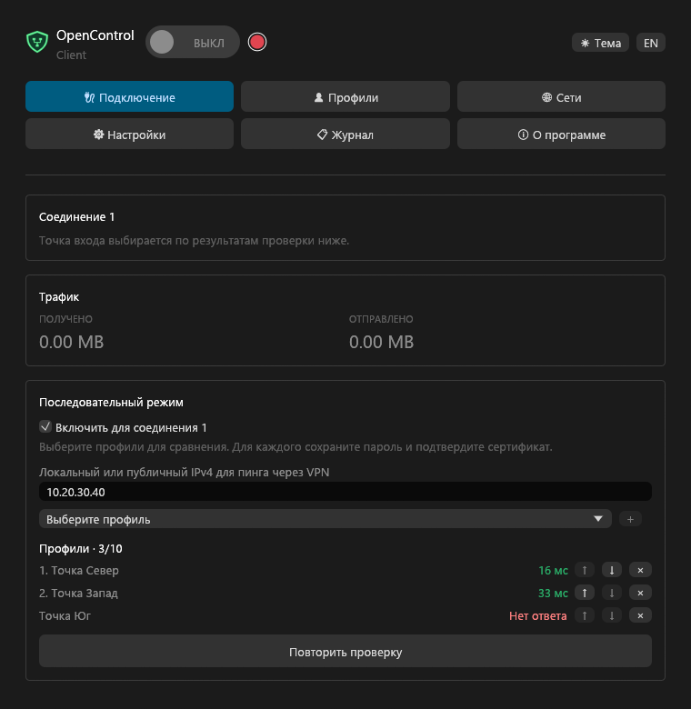
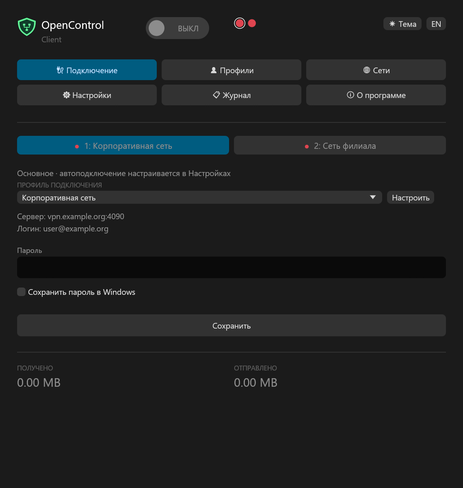
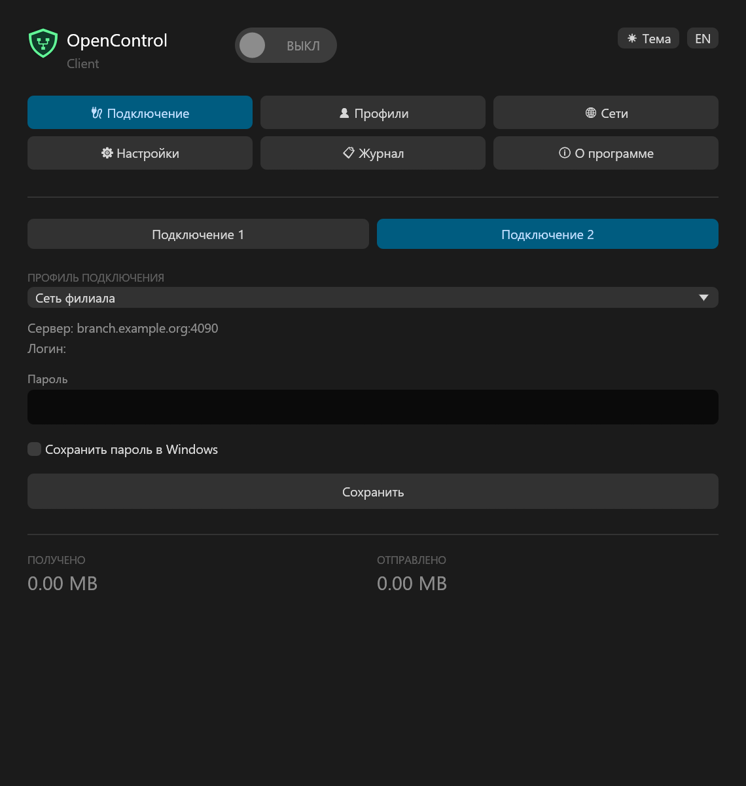
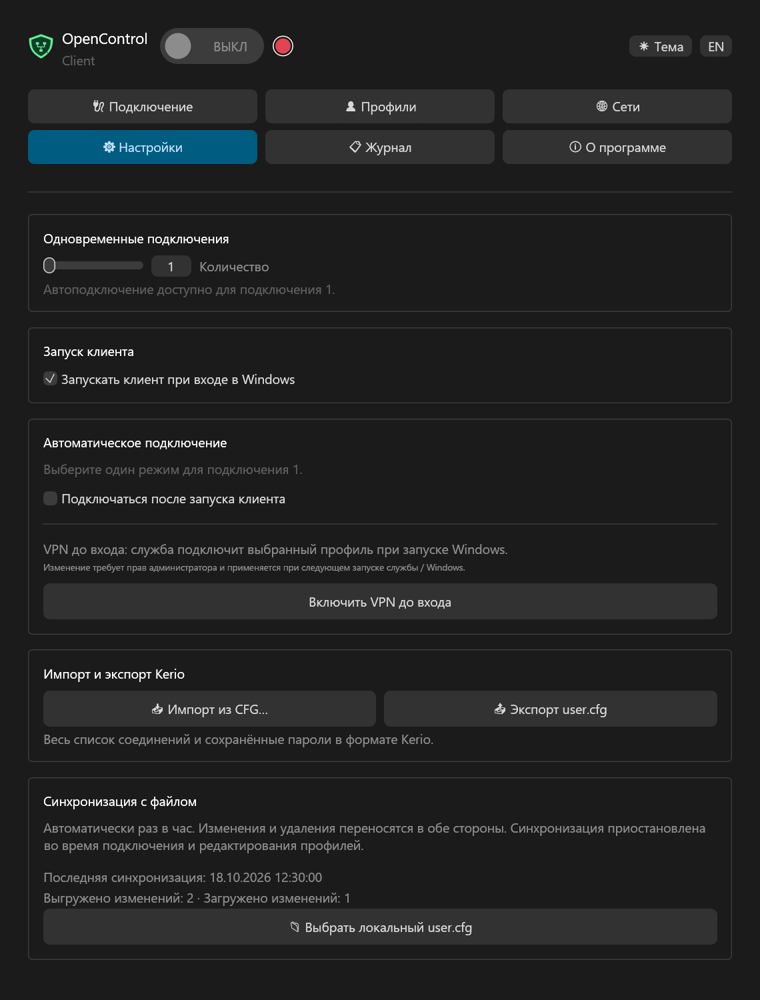
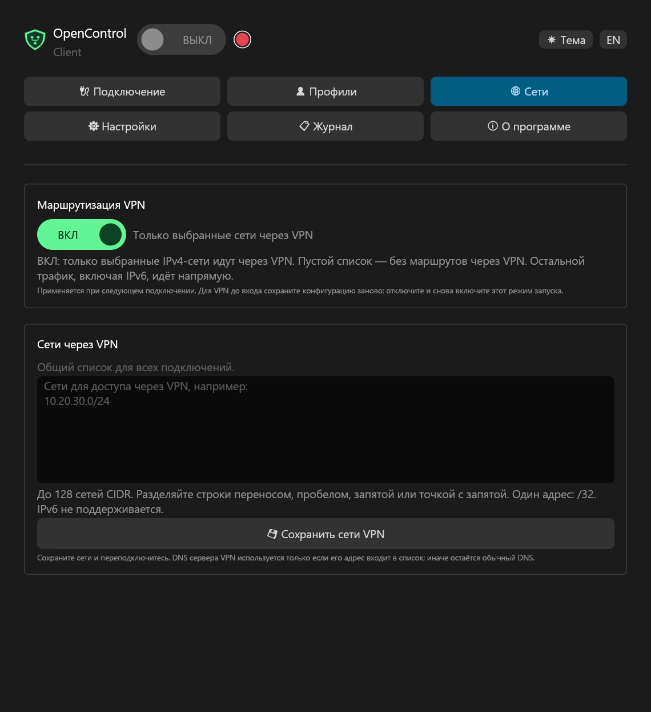
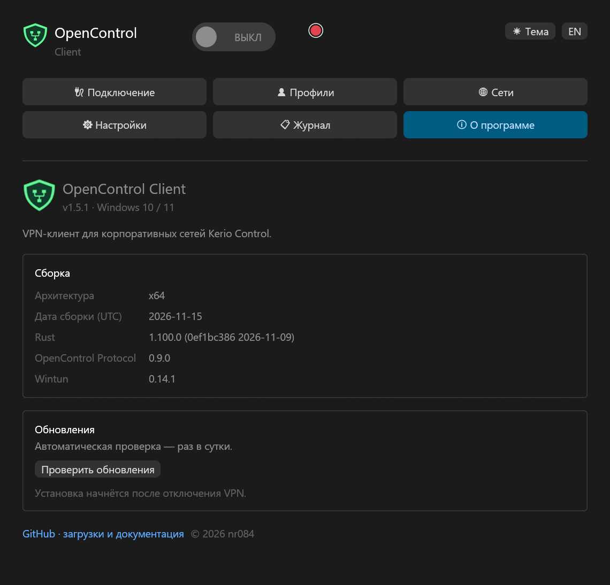
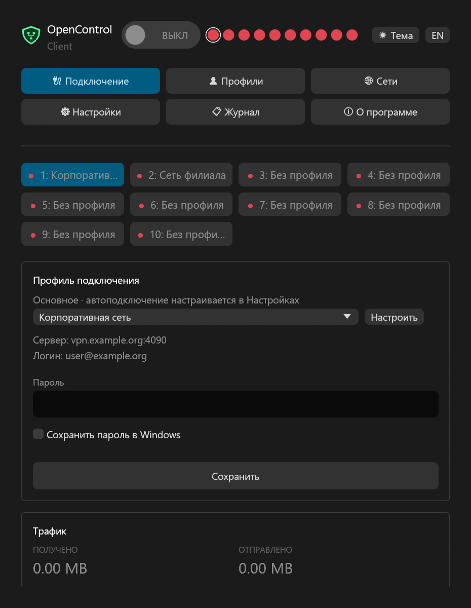
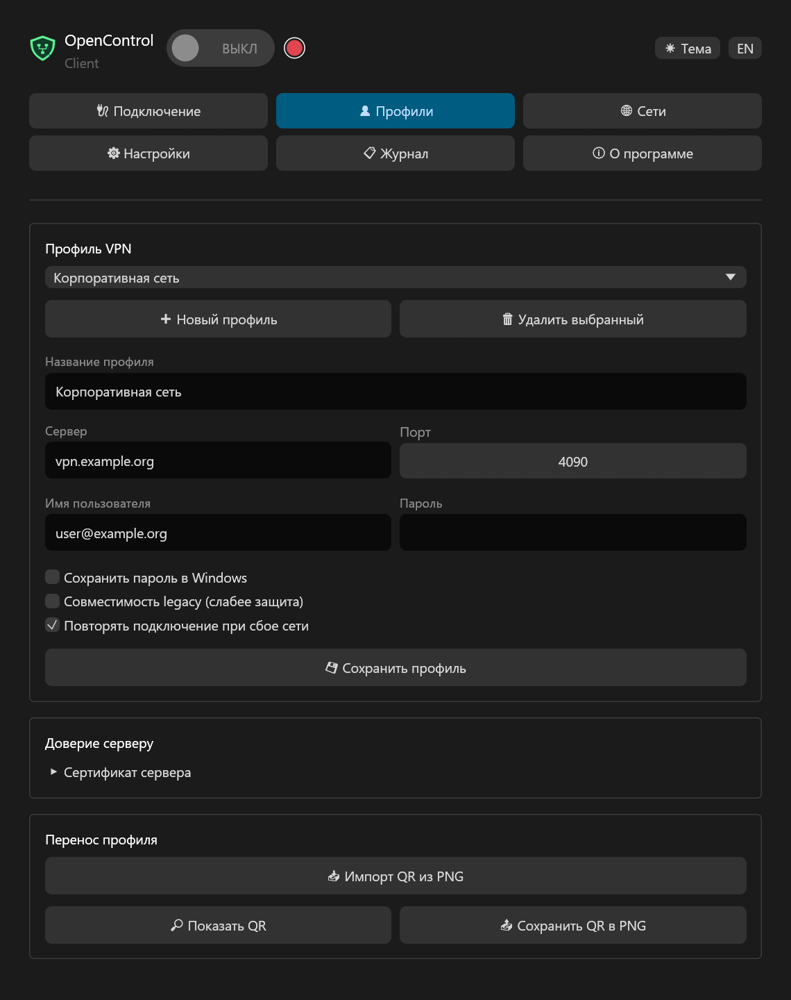
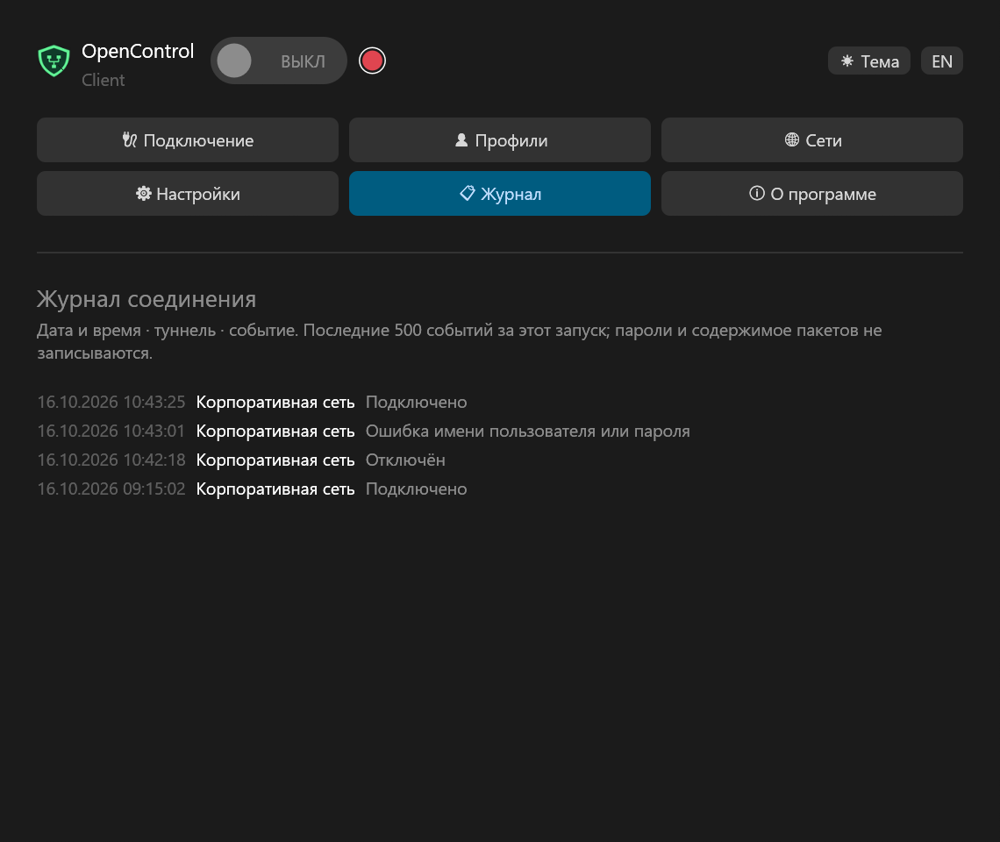

<h1 align="center">OpenControl Client</h1>

VPN для частных сетей Kerio Control · Windows 10 и 11

<b>Русский</b> · <a href="README.en.md">English</a>

<a href="https://github.com/nr084/opencontrol-client-windows-releases/releases/latest">Скачать 1.6.2</a> · <a href="RELEASE_NOTES.md">Changelog</a> · <a href="SHA256SUMS">SHA256</a>

Для подключения понадобятся адрес Kerio Control и учётные данные от вашей организации. OpenControl Client — независимый VPN-клиент.

После выключения или перезагрузки служба восстанавливает VPN до входа и повторяет попытки, если сеть или адаптер ещё не готовы.

## Установка

| Windows | Установщик |
|---|---|
| 64-разрядная Windows на Intel или AMD | [x64](https://github.com/nr084/opencontrol-client-windows-releases/releases/download/v1.6.2/OpenControl-client-1.6.2-windows-x64.msi) |
| 32-разрядная Windows 10 | [x86](https://github.com/nr084/opencontrol-client-windows-releases/releases/download/v1.6.2/OpenControl-client-1.6.2-windows-x86.msi) |
| Windows 11 на ARM, включая виртуальную машину на Mac | [arm64](https://github.com/nr084/opencontrol-client-windows-releases/releases/download/v1.6.2/OpenControl-client-1.6.2-windows-arm64.msi) |

Каждый MSI включает русский и английский. При первом запуске выбран русский, язык переключается кнопкой **EN / RU**. После установки откройте **Профили**, добавьте соединение или импортируйте его из Kerio, затем включите VPN. При первом подключении сверьте отпечаток сертификата с администратором.

## Одновременно до десяти VPN

Для **соединения 1** можно включить последовательный режим под блоком трафика. Добавьте до десяти профилей и проверьте через них локальный или публичный IPv4. Ответившие профили сортируются по среднему пингу и образуют очередь резервных точек входа. Режим по умолчанию выключен.

1. Во вкладке **Настройки** задайте число подключений от 1 до 10.
2. Во вкладке **Подключение** откройте нужную подвкладку, например **Подключение 2**, выберите профиль и нажмите **Сохранить**. Затем включите туннель переключателем вверху.
3. В трее открывайте меню нужного номера, чтобы сменить профиль, отключить или переподключить только этот туннель.

Точки рядом с ВКЛ/ВЫКЛ показывают состояние всех настроенных подключений. Левый щелчок открывает нужную подвкладку, правый — команды слота. При двух и более активных туннелях их количество видно на значке трея.

При двух и более настроенных слотах пункты «Подключить все» и «Отключить все» находятся над «Выйти» в трее. Каждая команда выдаёт одно уведомление Windows с результатами по всем затронутым туннелям. Пока работают другие туннели, можно добавлять профили и редактировать или удалять свободные.

Два независимых Kerio могут работать одновременно, если их корпоративные сети маршрутизируются однозначно. Можно также использовать первый туннель для интернета, а второй для сети филиала. VPN автоматически поднимается после входа или до входа в Windows только для подключения 1. Остальные включаются вручную.

Подключение 1 может принимать маршрут по умолчанию и назначать VPN DNS Windows. Дополнительные подключения используют маршруты к своим сетям. Для них доступны соединения по IP и имена, которые уже разрешает настроенный DNS. Одинаковые подсети, адреса серверов и выданные VPN IP могут конфликтовать. При неоднозначном совпадении OpenControl отклоняет конфликтующий маршрут или туннель. Закрытые сети планируйте с различными подсетями.

## Что ещё умеет клиент

| Раздел | Возможности |
|---|---|
| Профили | Сортировка, сохранение паролей средствами Windows, экспорт QR, ручной режим совместимости со старыми серверами |
| Настройки | Импорт из Kerio с выбором файла и обработкой дублей, экспорт, двусторонняя синхронизация с `user.cfg`, управление автозапуском |
| Сети | Один список для всех подключений. При сохранении клиент объединяет подсети и указывает строку, если в ней есть ошибка. Можно исключить указанные сети или пропускать через VPN только указанные сети, доступные через соответствующий сервер |
| Трей | Красная точка без VPN, зелёная при активном VPN, янтарный счётчик при двух и более туннелях. Подсказки с профилями и трафиком, уведомления, двойной щелчок для открытия или скрытия окна |
| Журнал | Время, номер подключения, профиль, подключение, отключение и ошибки |
| О программе | Версия клиента и Rust, дата сборки, ссылка на GitHub, ручная проверка обновления |

Скриншоты интерфейса

## Проверки и ограничения

Wintun подписан издателем драйвера. EXE и MSI OpenControl не имеют подписи издателя. Сверяйте [SHA256](SHA256SUMS). Штатное удаление доступно в списке установленных приложений Windows. Сведения о данных и лицензиях приведены в [политике конфиденциальности](PRIVACY.md) и [уведомлениях о сторонних компонентах](THIRD-PARTY-NOTICES.txt).
